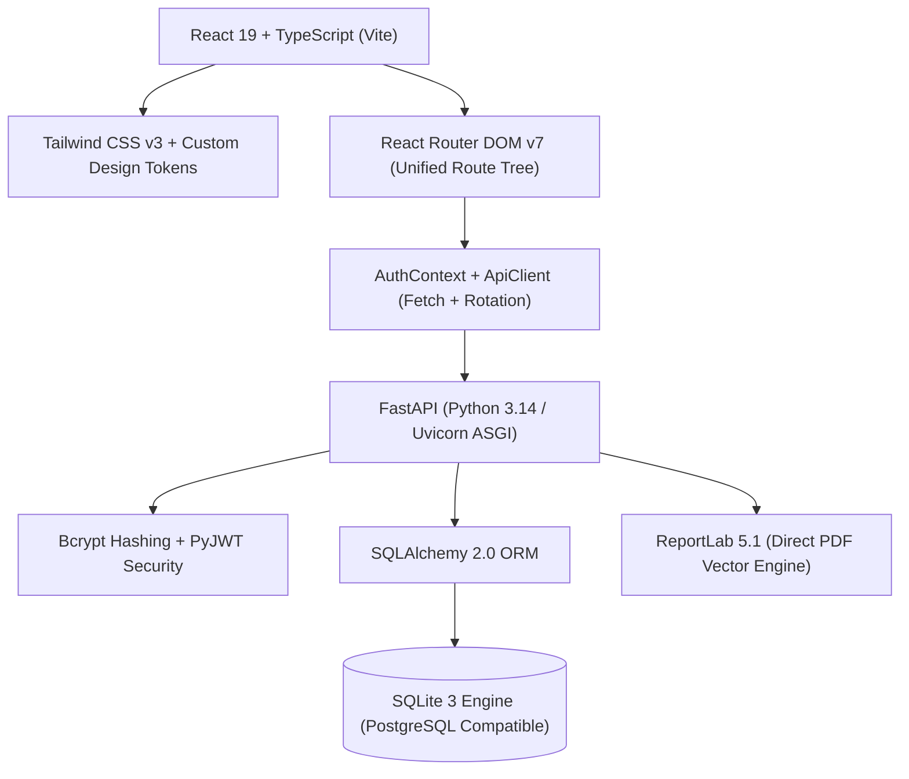
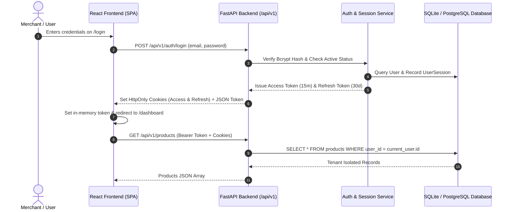
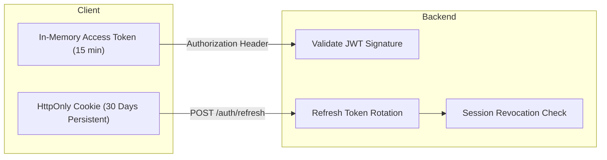
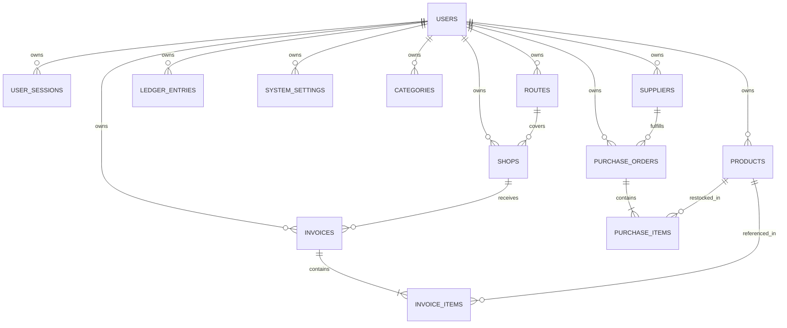

# MyBilling — Complete Technical Architecture & Developer Interview Guide
*Author & Lead Developer: Nitin Parashar*  
*Role Perspective: First-Person Engineering Deep Dive*

---

## 1. Project Introduction & Problem Statement

When I observed Indian FMCG (Fast Moving Consumer Goods) wholesale distribution centers and regional semi-wholesale merchants, I identified a severe software gap. Traditional ERP solutions like Tally or SAP are either prohibitively complex, require heavy keyboard-driven accounting expertise, or are completely disconnected from the rapid physical realities of warehouse dispatches and counter sales.

Distributors process hundreds of rapid transactions daily where:
- Orders must be punched in under 15 seconds.
- Inventory must immediately decrement without desynchronization across concurrent billing counters.
- Credit (*Udhar*) ledgers must be reconciled immediately without manual journal postings.
- Delivery trucks and beat routes demand structured shop allocations.
- Thermal receipt printers (50mm, 80mm) and formal GST A4 tax invoices must both be generated on-demand without layout breaking.

I engineered **MyBilling** as an executive-grade, high-velocity ERP and billing operating system specifically tailored for FMCG distributors and modern wholesale merchants. It combines an ultra-fast POS checkout interface with real-time profit analytics, double-entry automated accounting, purchase GRN (Goods Receipt Note) management, persistent JWT/cookie security, and complete multi-tenant workspace isolation.

---

## 2. Project Development Journey

I approached MyBilling in distinct, disciplined engineering phases:
1. **Domain Immersion & Core POS (Phase 1):** I first built the high-speed billing interface, designing domain-specific keyboard shortcuts (F9 to jump straight to billing, Enter navigation, instant item search), immediate cart computations, and barcode scanning emulation.
2. **Double-Entry Financial Core & Stock Movement (Phase 2):** Instead of simple CRUD tables, I architected an underlying automated ledger. When an invoice is finalized, it automatically creates corresponding double-entry accounting records (`REVENUE`, `CASH`/`BANK`, and `ACCOUNTS_RECEIVABLE` for Udhar credit) while atomically updating stock levels.
3. **Purchases, GRN & Wholesale Landed Cost (Phase 3):** I integrated supplier management and Goods Receipt Notes (GRN). Each incoming purchase order recalculates product landed cost and updates accounts payable balances.
4. **Landing Page & Conversion Experience (Phase 4):** A modern, dark-mode/light-mode hybrid public landing page was built with an interactive, in-memory billing simulation and thermal receipt animation to allow potential clients to test the workflow without registration.
5. **Unified Architecture, Authentication & Multi-Tenancy (Phase 5):** I consolidated the landing page into the primary React application, unified dependencies, centralized brand assets (`/Logo.png`), and implemented production-grade authentication with 30-day persistent sessions, refresh token rotation, and multi-tenant workspace isolation.

---

## 3. Actual Technology Stack & Selection Rationale



### Frontend Stack
- **React 19 & TypeScript:** Provides modern concurrent rendering, type safety across complex invoice states, and modular component reusability.
- **Vite 8:** Lightning-fast HMR (Hot Module Replacement) and optimized Rollup-based production chunking.
- **Tailwind CSS v3 (Custom Enterprise Design Tokens):** Designed with Stitch tokens, high-contrast surfaces (`bg-surface`, `surface-container-lowest`), and responsive layouts tailored for warehouse monitors and laptops.
- **Motion / Framer Motion:** Powers the interactive animated physical receipt printer feed simulation on the landing page.
- **Phosphor Icons & Lucide React:** Consistent visual iconography across ERP navigation and landing page marketing.

### Backend Stack
- **FastAPI (ASGI):** Chosen for sub-millisecond asynchronous request handling, automatic OpenAPI schema generation, Pydantic type validation, and native dependency injection (`Depends`).
- **SQLAlchemy 2.0:** Enterprise ORM supporting clean model relationships, eager joins, connection pooling, and atomic transaction rollbacks.
- **Bcrypt & PyJWT:** Industrial standard password hashing (cost factor 12) and cryptographically signed JWT access tokens.
- **ReportLab 5.1:** Direct Python PDF generation engine avoiding headless browser overhead to generate A4, 80mm, and 50mm receipts in under 50ms.
- **SQLite 3 (Development/Local) & PostgreSQL (Production Ready):** Configured via `DATABASE_URL` with thread-safe connection pooling.

---

## 4. Complete System Architecture



---

## 5. Landing Page & Frontend Integration

The landing page originally existed as an isolated project. I integrated it directly into `frontend/src/Landing Page/` and unified it into the main application:
- **Default Public Route:** Navigating to `/` renders the high-impact public `HomePage`.
- **Zero Design Drift:** I preserved every section: `HeroSection`, `AppPreviewSection`, `ReceiptSection`, `FeaturesSection`, `HowItWorksSection`, `AboutSection`, and `CtaBanner`.
- **CSS Architecture:** Merged all custom Tailwind tokens (`canvas-bg`, `surface-card`, `primary-glow`, `distributor-marquee-track`, `bg-grid-pattern`) into `frontend/src/styles/globals.css`.
- **Unified Routing:** Public routes (`/`, `/pricing`, `/login`, `/signup`) coexist seamlessly with protected ERP routes (`/dashboard`, `/billing`, `/products`, `/shops`, etc.) under a single `BrowserRouter`.

---

## 6. Authentication & Persistent Login

I implemented a dual-token security architecture designed to eliminate credential fatigue while maintaining strict trust boundaries:



### Persistence Mechanism
1. **User Login:** Upon credentials verification, backend generates:
   - A short-lived (15 min) signed JWT access token.
   - A cryptographically random refresh token string (`secrets.token_urlsafe(64)`).
   - A SHA-256 hash of the refresh token stored in `user_sessions`.
2. **HttpOnly Cookies:** Both tokens are set in `HttpOnly`, `SameSite=Lax` cookies. The refresh cookie has a `max_age` of 30 days.
3. **Surviving Computer Restarts:** When a user closes the browser or restarts their computer and returns to `http://localhost:5173`:
   - React mounts `AuthProvider`.
   - `AuthProvider` calls `/api/v1/auth/refresh`.
   - The browser automatically attaches the persistent HttpOnly cookie.
   - The backend validates the session record, generates a rotated refresh token, issues a new access token, and sets the user state.
   - The user seamlessly lands on their `/dashboard` without ever seeing the login prompt.
4. **Session Rotation:** On every refresh call, the old refresh token is replaced in the database with a newly generated one, defending against token replay attacks.
5. **Session Invalidation:** Manual logout explicitly sets `is_revoked = True` on the database session and clears cookies using `delete_cookie`.

---

## 7. Dashboard & Billing Functionality

### Dashboard (`/dashboard`)
- **Real-Time KPIs:** Gross Revenue, Net Profit (calculated using true cost of goods sold), Active Udhar Outstanding, and Invoice Velocity.
- **Sales Pulse Chart:** Intraday or 7-day/30-day sales vs. cash collection pulse curves rendered with Recharts.
- **Recent Invoices Ledger:** Interactive status monitor displaying payment modes (`CASH`, `UPI`, `UDHAR_CREDIT`).

### Fast POS Checkout (`/billing`)
- **Speed-Optimized Flow:** Full keyboard navigation (F9 to focus billing, quick payment hotkeys, barcode scanning detection).
- **Cart Calculations:** Real-time subtotal, item-wise discount percentage computations, and grand total.
- **Idempotency Defense:** Client generates an `X-Idempotency-Key` preventing accidental double-billing if a merchant clicks "Finalize" twice.

---

## 8. Invoice & PDF Generation

In `backend/app/services/pdf_service.py`, I built native vector PDF generation using ReportLab:
- **Formats Supported:**
  - `A4`: Formal tax invoice with two-column seller/buyer details, itemized table, HSN/SKU, payment terms, and signature block.
  - `80mm`: Standard thermal POS receipt for counter sales.
  - `50mm`: Compact thermal format for micro mobile printers.
- **Profit Report PDF:** Generated specifically for business owners to audit cost vs. margin per bill line.
- **Centralized Logo Integration:** PDFs dynamically retrieve the store's configured logo or fallback to store branding text.

---

## 9. Receipt Printing System

To deliver an exceptional user experience on the landing page, I built an interactive receipt printer simulation (`ReceiptSection.tsx` & `receiptPrinter.tsx`):
- Uses physics-based Framer Motion animations to simulate paper feeding from a thermal printer.
- Emulates thermal paper textures using SVG noise patterns (`/textures/receipt-paper.svg`).
- Allows visitors to test real-world items, observe subtotal calculations, and print demo slips directly in the browser.

---

## 10. Product, Purchase & Inventory Management

### Product Inventory
- Product entity tracks `sku`, `barcode`, `name`, `pack_size`, `landed_cost`, `wholesale_rate`, `mrp`, and `stock_qty`.
- Stock status is dynamically classified as `SAFE`, `MODERATE`, `LOW`, or `DEPLETED` based on `min_stock_threshold`.
- Inventory valuation endpoint calculates total capital tied up in stock at landed cost vs. potential wholesale realization.

### Purchases & GRN (Goods Receipt Notes)
- When stock arrives from suppliers, the merchant logs a `PurchaseOrder`.
- The system increments product inventory atomically and updates the product's historical `landed_cost`.
- Automatically posts an `ACCOUNTS_PAYABLE` entry in the ledger against the supplier.

---

## 11. Profit & Reporting System

Many standard billing systems only calculate gross revenue. In MyBilling, I architected a true **Cost of Goods Sold (COGS)** profitability engine:
- When an invoice is created, each line item stores a permanent snapshot of `unit_rate` (selling price) and `landed_cost` (purchase cost at the moment of sale).
- **Net Profit Formula:**  
  $$\text{Net Profit} = \sum [(\text{Unit Rate} - \text{Landed Cost}) \times \text{Quantity} - \text{Discount Amount}]$$
- Because historical costs are snapshotted on the line item, future supplier price changes never distort past profit reports.
- Generates 7-day profit trends, category margin breakdowns, and GST tax summaries.

---

## 12. Database Design & Relationships



---

## 13. Multi-User Architecture & Data Isolation

Data isolation is enforced at the database and query level, never relying solely on frontend routing:
1. **Foreign Key Ownership:** All business tables (`products`, `shops`, `invoices`, `ledger_entries`, `purchase_orders`, etc.) contain a `user_id` column referencing `users.id`.
2. **Server-Side Identity:** The backend dependency `get_current_user` extracts the authenticated user from the validated JWT token. The client can never supply an arbitrary `user_id`.
3. **Scoping on Every Query:** Every single database read, update, and delete operation explicitly includes `.filter(Model.user_id == current_user.id)`.
4. **IDOR Defense:** If Tenant A attempts to read or mutate `/api/v1/invoices/42` belonging to Tenant B, the query returns `404 Not Found`, completely mitigating Insecure Direct Object Reference vulnerabilities.

---

## 14. Master Admin Functionality

- **Explicit Separation:** Regular signups assign role `"user"`. Master admin status is never assigned automatically and cannot be claimed via registration.
- **Secure Provisioning:** Provisioned through backend CLI command:
  ```bash
  python -m backend.app.db.provision_admin --email admin@mybilling.com --name "Nitin Parashar" --password "SecureSecret@123"
  ```
- **Administrative Privileges (`get_current_admin`):**
  - View all registered tenant businesses across the platform (`GET /api/v1/admin/users`).
  - Activate or disable user accounts (`PATCH /api/v1/admin/users/{id}/status`).
  - Perform system-wide, all-tenant backup exports (`GET /api/v1/admin/backup/export-system`).
  - Restore system-wide backups transactionally (`POST /api/v1/admin/backup/restore-system`).

---

## 15. Complete Database Export & Import Architecture

- **Tenant-Level Import/Export (`data_transfer.py`):** Individual merchants can export and import their catalog and customer lists in mobile-friendly JSON format without risking invoice corruption.
- **System-Wide Master Backup (`admin.py` & `backup.py`):**
  - Master Admin can export an exhaustive JSON snapshot containing all tenants, products, invoices, line items, and relationships.
  - Low-level SQLite snapshots (`.db` files) are created using SQLite's online backup API with integrity checks (`PRAGMA integrity_check`).
  - Restorations run inside atomic database transactions (`db.begin()`); any structural error automatically rolls back changes to preserve system stability.

---

## 16. Demo Mode Architecture

The landing page features an "Explore Live Demo" mode:
- **Complete Isolation:** Runs entirely in client-side React state inside `AppPreviewSection.tsx`.
- **Zero Production Mutation:** Demo cart actions, item additions, and receipt printing simulations never call backend write APIs.
- **Ephemeral State:** Refreshing the tab automatically clears all demo data back to clean initial states.

---

## 17. Security Implementation

- **Password Storage:** Salted and hashed using `bcrypt` (12 rounds). Plain text passwords are never stored or logged.
- **JWT Protection:** Signed with HMAC-SHA256 using a server-side `JWT_SECRET_KEY`.
- **Persistent Token Rotation:** Refresh tokens stored as SHA-256 hashes in database; rotated upon every token renewal.
- **Cookie Security:** Cookies configured with `HttpOnly=True`, `SameSite=Lax`, and `Secure` in production environments.
- **CORS Protection:** Configured with strict origin checks for local development (`localhost:5173`, `127.0.0.1:5173`) and production domains.
- **Audit Logging & Idempotency:** Thread-safe caching on invoice creation prevents double-billing under network latency.

---

## 18. Actual Technical Challenges & Solutions

| Challenge Encountered | Root Cause | Engineering Solution |
| :--- | :--- | :--- |
| **Tailwind v4 vs v3 Mismatch** | Landing page used Tailwind v4 `@theme` CSS while main ERP used Tailwind v3 `tailwind.config.js`. | Merged all color tokens, fonts, and box shadows into `tailwind.config.js` and added custom utility classes (`.distributor-marquee-track`, `.bg-grid-pattern`) to `globals.css`. |
| **TypeScript `baseUrl` Deprecation** | TypeScript 6.0+ deprecated `baseUrl` in `tsconfig.json`. | Configured Vite resolve alias `@/ -> src/` and added `"ignoreDeprecations": "6.0"` to compiler options. |
| **Slow Build from Nested node_modules** | Standalone Landing Page folder contained a legacy `node_modules` directory causing duplicate package scanning. | Consolidated all dependencies (`motion`, `@bible-strong/avatar-react`, `@phosphor-icons/react`, `react-router-dom`) into the root `frontend/package.json` and cleanly removed nested node_modules. |
| **Seamless Persistent Login** | Requirement to survive browser close and machine restarts without storing tokens in vulnerable `localStorage`. | Implemented dual-token architecture: short-lived in-memory access token + 30-day HttpOnly refresh token with silent restoration in `AuthProvider`. |
| **Safe Database Multi-Tenant Migration** | Existing `mybilling.db` had 9 products, 5 shops, and 2 invoices with no `user_id` column. | Wrote `migrate_multitenant.py` which dynamically inspects SQLite schema via `PRAGMA table_info` and safely executes `ALTER TABLE ADD COLUMN user_id INTEGER DEFAULT 1`, preserving 100% of existing historical data. |

---

## 19. Important Source Files & Responsibilities

### Frontend Core
- `frontend/src/app/router.tsx`: Unified routing tree connecting public landing page, pricing, auth, and protected ERP routes.
- `frontend/src/context/AuthContext.tsx`: Manages user authentication lifecycle, silent token restoration, login, signup, and logout.
- `frontend/src/services/api/apiClient.ts`: Enterprise Fetch client with automatic cookie inclusion, Bearer token injection, and 401 token refresh queue.
- `frontend/src/components/common/Logo.tsx`: Centralized brand logo rendering `/Logo.png` with configurable sizing.
- `frontend/src/Landing Page/src/pages/HomePage.tsx`: Public marketing home page with interactive live demo.
- `frontend/src/Landing Page/src/pages/PricingPage.tsx`: Dedicated pricing tier overview with centralized social links.
- `frontend/src/Landing Page/src/pages/LoginPage.tsx`: Corporate login form connected to real backend authentication.
- `frontend/src/Landing Page/src/pages/SignupPage.tsx`: Merchant registration with live password strength evaluation.

### Backend Core
- `backend/app/main.py`: FastAPI application entry point, CORS middleware, OpenAPI metadata, and lifecycle hooks.
- `backend/app/core/security.py`: Bcrypt password hashing, JWT generation, and cryptographic token generation.
- `backend/app/core/config.py`: Centralized environment settings (`JWT_SECRET_KEY`, `DATABASE_URL`, cookie parameters).
- `backend/app/api/deps.py`: Fast dependency injection providers (`get_db`, `get_current_user`, `get_current_admin`).
- `backend/app/api/v1/auth.py`: Authentication endpoints (`/signup`, `/login`, `/refresh`, `/logout`, `/me`).
- `backend/app/api/v1/admin.py`: Master Admin operations (`/users`, `/backup/export-system`, `/backup/restore-system`).
- `backend/app/api/v1/billing.py` & `billing_service.py`: High-speed invoice generation, ledger entries, and stock decrement.
- `backend/app/services/pdf_service.py`: Direct vector PDF generation engine for A4, 80mm, and 50mm invoices.
- `backend/app/db/migrate_multitenant.py`: Zero-data-loss database schema migration for multi-tenancy.
- `backend/app/db/provision_admin.py`: CLI tool for secure Master Admin account provisioning.

---

## 20. Project Setup & Execution Commands

### Prerequisites
- Python 3.10+ (Tested on Python 3.14)
- Node.js 18+ and npm

### 1. Backend Setup
```bash
# Navigate to project root
cd MyBilling

# Activate virtual environment
.\venv\Scripts\activate

# Install dependencies
pip install -r backend/requirements.txt

# Run multi-tenant schema migration
python -m backend.app.db.migrate_multitenant

# (Optional) Provision Master Admin
python -m backend.app.db.provision_admin --email admin@mybilling.com --name "Nitin Parashar" --password "AdminPassword@123"

# Start FastAPI backend server (Runs on http://127.0.0.1:8000)
python run_backend.py
```

### 2. Frontend Setup
```bash
# Navigate to frontend directory
cd frontend

# Install consolidated dependencies
npm install

# Verify production build
npm run build

# Start Vite development server (Runs on http://localhost:5173)
npm run dev
```

### 3. One-Click System Launcher
Windows users can simply double-click `start.bat` in the project root to launch both the backend and frontend simultaneously.

---

## 21. One-Minute Project Explanation (Elevator Pitch)

> "MyBilling is a high-speed ERP and POS operating system engineered specifically for FMCG wholesale distributors and multi-channel merchants. I built it to bridge the gap between complex accounting software like Tally and fast-paced warehouse dispatch operations. It allows distributors to finalize invoices in under 15 seconds with automated double-entry ledger bookkeeping, real-time inventory decrement, and true landed-cost profit calculations. 
> 
> Technically, it is architected with a React 19 and TypeScript frontend styled with enterprise Tailwind design tokens, and a high-performance Python FastAPI backend backed by SQLAlchemy. I built a dual-token authentication system that keeps merchants securely logged in across browser closes and computer reboots using HttpOnly cookies and refresh token rotation, while strictly isolating every merchant's products, invoices, and financial reports at the database query level."

---

## 22. Three-Minute Project Explanation (System Architecture Pitch)

> "When building MyBilling, I focused on three core engineering pillars: checkout velocity, financial integrity, and multi-tenant security.
> 
> First, on checkout velocity: FMCG distributors cannot afford lag. I built the billing interface with keyboard shortcuts (like F9 billing navigation), instant barcode emulation, and live in-memory cart calculations. To prevent duplicate billing during network hiccups, every invoice submission is protected by an in-memory thread-safe idempotency cache. Invoices can be exported instantly to A4 tax PDFs, 80mm receipts, or 50mm mobile thermal slips using a direct ReportLab vector engine that generates files in under 50 milliseconds.
> 
> Second, on financial integrity: Unlike surface-level billing apps, MyBilling maintains an automated double-entry ledger. Every sale posts credit to revenue and debit to cash, bank, or accounts receivable for credit Udhar. For suppliers, incoming Goods Receipt Notes (GRN) automatically recalculate product landed costs and post accounts payable. Profitability reports calculate true margins by taking snapshots of item purchase costs at the moment of sale, ensuring future price fluctuations never distort past financial audits.
> 
> Third, on security and integration: I integrated a separately developed, conversion-focused landing page into the main React Vite application with zero visual degradation. For authentication, I implemented Bcrypt password hashing with PyJWT access tokens paired with 30-day persistent HttpOnly refresh cookies with automatic rotation. Every database query in the application is programmatically scoped to the authenticated tenant's identity, preventing IDOR vulnerabilities. Finally, I built a Master Admin infrastructure allowing system-wide, transaction-safe JSON backups and user governance."

---

## 23. Five-Minute Detailed Technical Explanation (Deep Dive)

> "In an enterprise interview, I'd like to walk through the lifecycle of an invoice transaction in MyBilling and how it highlights the end-to-end architecture:
> 
> **1. Client-Side State & Routing:**
> The frontend is a React 19 single-page application built on Vite. When an unauthenticated visitor enters, `AppRouter` serves the public `HomePage` with an interactive, in-memory billing simulation that never hits write endpoints. When a merchant signs in, `AuthProvider` calls `/api/v1/auth/login`. The FastAPI backend verifies the credentials using `bcrypt.checkpw`, creates a `UserSession` record storing a SHA-256 hash of a cryptographically random refresh token, and returns both an access token and an HttpOnly persistent cookie. The user is redirected to `/dashboard`.
> 
> **2. Resilient API Communication & Silent Token Refresh:**
> All HTTP communications pass through `apiClient.ts`. It maintains the access token in memory while configuring `credentials: 'include'`. If a merchant leaves their desk and the 15-minute access token expires, the client intercepts the 401 response, enqueues pending calls, and issues a background `POST /api/v1/auth/refresh`. The backend validates the persistent cookie, rotates the refresh token in the database, and returns a new access token. The enqueued requests replay transparently with zero user interruption.
> 
> **3. Atomic Invoice Execution & Concurrency:**
> When a merchant finalizes an invoice on `/billing`, the payload arrives at `create_sale_invoice` in `billing_service.py`. The endpoint accepts an `X-Idempotency-Key` to protect against double submission. Inside an atomic database transaction:
> - Line items are validated and stock quantities are decremented with pessimistic locking (`with_for_update()`) to prevent race conditions during concurrent checkouts.
> - The invoice records the customer details, payment mode (`CASH`, `UPI`, `UDHAR_CREDIT`), and calculates total discount.
> - Each line item records a historical `landed_cost` snapshot from the product master.
> - If Udhar credit was extended, the shop's `current_balance` is automatically incremented.
> - The automated ledger immediately posts corresponding entries (`REVENUE`, `CASH`/`BANK`, and `ACCOUNTS_RECEIVABLE`).
> 
> **4. Multi-Tenant Query Scoping:**
> Notice that `user_id` is never accepted from the request body. Instead, FastAPI's `Depends(get_current_user)` extracts and verifies the identity from the authenticated JWT. Every subsequent query—whether fetching products, listing shops, or generating profit analytics—applies `.filter(Model.user_id == current_user.id)`. This guarantees total workspace isolation.
> 
> **5. Master Admin & Disaster Recovery:**
> For platform administrators, I built specialized endpoints protected by `Depends(get_current_admin)`. The Master Admin can trigger a complete system-wide JSON backup that exports all tenants, products, invoices, and ledger entries with preserved relational keys. In the event of a disaster, the transactional restore endpoint validates schema integrity and rebuilds the multi-tenant database inside an atomic transaction, rolling back automatically if any entity fails."

---

## 24. Limitations & Future Scope

### Current Limitations
1. **Single Currency per Tenant:** Currently optimized for INR (₹) with standard regional tax layouts; multi-currency exchange conversion is not yet built into invoice ledgers.
2. **Synchronous PDF Streaming:** PDFs are generated synchronously on-demand via ReportLab. While generation is under 50ms, bulk exports of 10,000+ invoices should ideally be offloaded to an asynchronous Celery/Redis worker queue.
3. **SMS / WhatsApp Gateway:** Payment receipts are currently printed or saved as PDF; direct automated WhatsApp Business API dispatch is ready for webhook integration but not yet active.

### Future Engineering Scope
1. **Offline-First PWA Synchronization:** Integrate IndexedDB and service workers with background sync, enabling warehouse billing counters to continue punching bills during complete internet blackouts and sync upon reconnection.
2. **Multi-Warehouse Stock Transfers:** Support inter-warehouse stock transfer memos (STMs) with transit tracking.
3. **AI Demand & Expiry Forecasting:** Analyze sales velocity across seasons to automatically forecast re-order quantities and trigger proactive supplier purchase orders.
